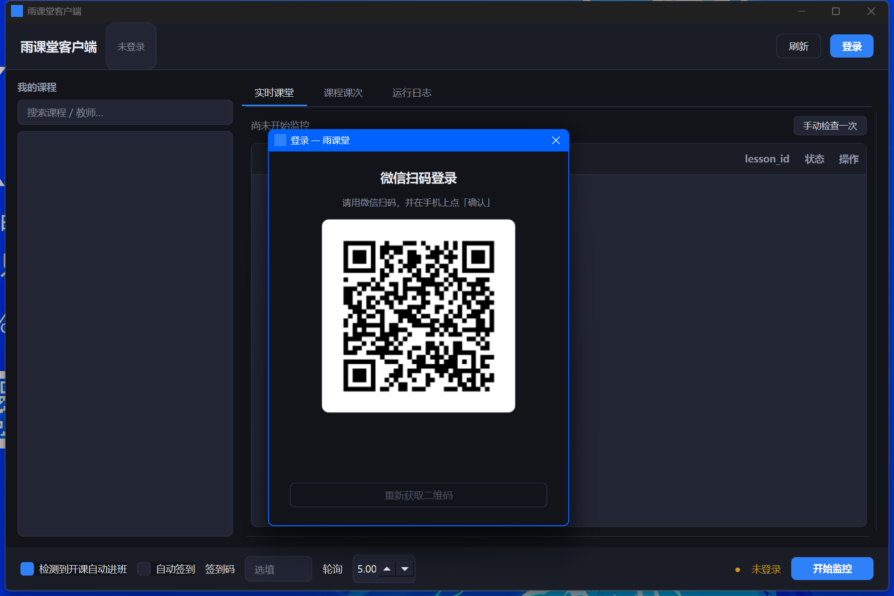

# 雨课堂 Web 协议研究

对雨课堂（长江雨课堂）**公开 Web 前端**与后端之间协议的一次独立研究，附带一个用于验证结论的客户端。

协议事实来自 PC 端 web bundle 的静态提取 + 端点实测，不依赖任何私有资料。

**核心结论：雨课堂没有 `join` 接口。进班不是一次请求，而是「凭 session 直连课堂接口」。二维码里的 `sign` 只约束非名单人员（旁听生），对在册学生是冗余参数。**

---

## ⚠️ 使用前必读

**这个仓库在研究协议，不是在帮你处理学业事务。**请先读 [SECURITY.md](SECURITY.md)，里面写了凭据怎么存的（明文，不假装加密）、有哪些风险、以及什么行为会被认定为伪造考勤。

三句话概括：

1. **只操作你自己的账号**，只进入你自己已选课的课堂。
2. **默认请用观察模式**，它只检测开课并提示，不动手：
   ```bash
   python ykt.py watch --observe
   ```
   GUI 里取消勾选「检测到开课自动进班」效果相同。
3. **「自动签到」是自动化考勤。** 人不在课堂却让它签到属于伪造出勤，违反课堂纪律。
   这个项目把该开关默认关闭，且**不实现**「超时补答 / 改成绩」那类功能。

本项目与北京慕华信息科技有限公司无任何隶属或授权关系。使用可能违反雨课堂用户协议，
后果由使用者承担。代码按 MIT 协议「原样」提供，不附带任何担保。

---

## 致谢

协议认知建立在以下公开资料之上，详见 [NOTICE.md](NOTICE.md)：

- **[《工小湖：给雨课堂与学校教务做了个小程序》](https://blog.jiclub.site/2026/yuketang-deep-dive)** by Cталин — 提供了「`sign` 只约束旁听生」的关键判断
- **[RainClassSDK](https://github.com/Auto-CQUPT-Plan/RainClassSDK)** by Auto-CQUPT-Plan — 接口清单与鉴权头约定
- **[rainclassroom-scrapper](https://gitbucket.skyw.top/physicsdolphin/rainclassroom-scrapper)** by physicsdolphin — **WebSocket 扫码登录的具体实现**，没有这份参考本项目登录部分无从下手
- **[Ajax 的雨课堂爬虫笔记](https://aajax.top/2025/01/10/YuketangScrapper/)** — 课程/课次接口与 `offset` 实为 PageSize 的坑

需要说明：本项目与原博客的部分技术结论**看起来**有分歧，但其中一条已被证伪（是本文曾经的判断失误）：

- 早期本文断言「登录是 WebSocket，博客说的长轮询不存在」。查证后发现：
  **博客的长轮询是他自建网关 `hnit.jiclub.site` 的 `POST /api/ykt/auth/login-qr`**，
  而 PC 网页端确实是 WebSocket。两者都对，是两个不同的客户端。
  详见 [GONGXIAOHU-ANALYSIS.md](GONGXIAOHU-ANALYSIS.md)。
- 其余差异（`get_user_course_list` 端点名、`status == 1` 判断）仍按对照表处理。

### 关于「工小湖」这个 App 的一点提示

本文对它做过一次静态分析，结论放在 [GONGXIAOHU-ANALYSIS.md](GONGXIAOHU-ANALYSIS.md)。
一句话版本：它会把你雨课堂的**会话 cookie 发往作者自建服务器**，签到也由那台服务器代签。
它能自动签到，成立前提是**老师没开大屏动态码**——开了之后它同样签不上。

这不是漏洞指控，是数据流向的事实。用不用，你自己权衡。

---

## 三种用法



### 1. GUI 客户端（推荐）

已打包好的单文件程序：`dist/YuketangClient.exe`，双击即用，不需要装 Python。

从源码跑：

```bash
pip install -r requirements.txt
python app_gui.py
```

界面结构：

```
┌──────────────────────────────────────────────────────────────┐
│ 雨课堂客户端   [姓名·学校·学号]              [刷新]  [登录]    │
├───────────────┬──────────────────────────────────────────────┤
│ 我的课程       │  实时课堂 │ 课程课次 │ 运行日志              │
│ [搜索…]        │  ┌──────────────────────────────────────┐    │
│ ┌───────────┐ │  │ 课堂        lesson_id  状态   操作    │    │
│ │高等数学    │ │  │ 高数A(下)   998877    进行中 [进班][签到]│  │
│ │ 班级·教师  │ │  └──────────────────────────────────────┘    │
│ │大学物理    │ │                                              │
│ └───────────┘ │                                              │
├───────────────┴──────────────────────────────────────────────┤
│ ☑自动进班  ☐自动签到  签到码[__]  轮询[5s]  ● 监控中  [停止]  │
└──────────────────────────────────────────────────────────────┘
```

功能：

- **扫码登录** — 内嵌二维码，登录态落盘，下次自动恢复
- **课程列表** — 搜索过滤；双击课程看它的课次
- **实时课堂** — 轮询开课状态，检测到自动进班，表格每行可手动进班/签到
- **课程课次** — 列出该课所有课次（回放/课件），任意课次可单独进班
- **运行日志** — 全量请求日志，出问题看这里

### 2. 命令行

```bash
python ykt.py probe      # 免登录自证端点真实性
python ykt.py login      # 微信扫码一次
python ykt.py courses    # 列课程
python ykt.py live       # 查正在上课的课堂
python ykt.py live --raw # 同上，并打印服务端原始字段（字段名对不上时用这个）
python ykt.py watch --observe   # 【推荐】只检测开课，不进班不签到
python ykt.py watch      # 常驻轮询自动进班
python ykt.py enter 998877
python ykt.py checkin 998877 1234
```

### 3. Android APK

`dist/YuketangStudy-0.1.0-debug.apk`（60 KB，debug 签名，直接安装）。

**这不是桌面版打包过来的**——PySide6 没有 Android 目标，所以是独立重写的一份：
纯 Java + 原生 Views + `HttpURLConnection`，零第三方依赖。详见 [android/README.md](android/README.md)。

登录方式和桌面版不同：手机没法用微信扫自己屏幕上的码，所以改成
**截图 → 微信「扫一扫」→ 相册 → 选截图 → 确认**，App 自动轮询拿到 `sessionid`。
这条链路走的是微信开放平台的 HTTP 轮询，不是桌面版的 WebSocket。

从源码构建：

```bash
cd android
# 需要 JDK 17 + Android SDK (compileSdk 34)
export JAVA_HOME=/path/to/jdk-17
export ANDROID_HOME=/path/to/android-sdk
./gradlew assembleDebug
adb install -r app/build/outputs/apk/debug/app-debug.apk
```

> ⚠️ APK **能编译、包结构已校验（aapt2 + apksigner），但没有在真机或模拟器上跑过**。
> UI 细节、微信扫码的实际识别、国产 ROM 上的后台存活，都需要你自己验证。

## 打包（桌面端）

```bash
pip install pyinstaller
python build.py            # 目录版，启动快
python build.py --onefile  # 单文件版，分发方便
```

产物在 `dist/`。`build.py` 已经排除了 PySide6 的 WebEngine/QML/Multimedia 等无关模块，体积比默认小一半。

## 实测端点矩阵

| 端点 | 方法 | 免鉴权 | 说明 |
|---|---|---|---|
| `/v2/api/web/courses/list?identity=2` | GET | 否 | 课程列表，要 `sessionid` |
| `/v2/api/web/classroom_archive` | GET | 否 | 归档课程 |
| `/v2/api/web/logs/learn/{cid}?actype=-1&page=0&offset=500&sort=-1` | GET | 否 | 课次列表（`offset` 实际是 PageSize）|
| `/api/v3/classroom/on-lesson-upcoming-exam` | GET | 否 | **正在上课的真实数据源**，读 `data.onLessonClassrooms` |
| `/v/course_meta/on_lesson_courses` | GET | **是** | 兜底。无论登录与否都返回 `{"success":true,"data":{"on_lessons":[]}}`，实际是空的 |
| `/api/v3/classroom/on-lesson` | GET | 否 | 兜底 |
| `/api/v3/lesson-summary/student?lesson_id=X` | GET | 否 | **进班本体**：拿到即已进班 |
| `/api/v3/lesson-summary/student/presentation?presentation_id=&lesson_id=` | GET | 否 | 课件 |
| `/api/v3/lesson/notkn/checkin` | POST | 否 | 签到 `{source, inviteCode}` |
| `/api/lesson/web_check_in` | POST | 否 | 旧签到，需 CSRF |
| `/api/v3/user/basic-info` | GET | 否 | 判活 |

## 登录态：扫一次就够了

`sessionid` 存在本地，每次启动直接复用，**不需要反复扫码**。只在四种情况要重扫：

1. 服务端会话过期
2. 点了「退出」
3. 卸载 / 清除数据（桌面版则是删掉 `session.json`）
4. 切换了后端域名（cookie 绑域名）

启动时会校验一次，并区分两种情况——这个区分很重要：

| 结果 | 行为 |
|---|---|
| 会话有效 | 正常使用，界面显示「已登录 · 姓名 · 已 N 天」 |
| **服务端判定过期** | 清凭据并明确提示「登录已失效（上次登录 N 天前）」 |
| **只是没网** | **保留凭据**，只提示联网后重试 |

第三行是关键：如果不区分，断网时也会把人踢去重新扫码，白扫一次。
Android 版（v0.1.3+）行为与此一致。

## 登录协议（桌面版：WebSocket）

默认后端是 **长江雨课堂 `changjiang.yuketang.cn`**（根路径 302 → `/web`）。`changjiang.ykt.io` 是同一后端的别名域名，可以在登录框的下拉里切换。

```
wss://changjiang.yuketang.cn/wsapp/
  → send {"op":"requestlogin","role":"web","version":1.4,"type":"qrcode","from":"web"}
  ← {"op":"requestlogin","loginid":"<uuid>","expire_seconds":60,
     "ticket":"https://mp.weixin.qq.com/cgi-bin/showqrcode?ticket=...",
     "qrcode":"http://weixin.qq.com/q/02I3...","isReply":true}
  ← {... "subscribe_status":..., "UserID":..., "Auth":...}   # 扫码确认后
GET  /v/course_meta/user_info          # 顺带下发 csrftoken
POST /pc/web_login  {"UserID":..,"Auth":..}  → Set-Cookie: sessionid
```

三个容易踩的点：

1. **`UserID`/`Auth` 在 `subscribe_status` 那条消息里**，不在第一帧。只存第一帧会导致"扫码成功但一直报登录失败"。
2. **`qrcode` 字段是 `http://weixin.qq.com/q/...` 短链，不是 qrconnect URL**，直接把它编码成二维码即可。`ticket` 字段则是微信官方二维码图片地址。
3. **二维码只有 `expire_seconds`（实测 60）秒有效期**，过期必须重新发 `requestlogin` 换新码。

## 扫码不行时：粘 Cookie

扫码链路受微信端状态影响，偶发失败很正常。兜底路径是直接粘浏览器里的 `sessionid`：

1. 浏览器打开 `https://changjiang.yuketang.cn/web` 并登录
2. F12 → Application → Cookies → 选中该域名 → 复制 `sessionid` 的值
3. GUI 登录框点「扫码不行？粘贴 Cookie」；或命令行：

```bash
python ykt.py cookie <sessionid>
```

## 切换后端

```bash
python ykt.py host                 # 看当前 + 可选项
python ykt.py host 雨课堂专业版      # 切换并记住
python ykt.py login --host 长江雨课堂
```

可选：`长江雨课堂` / `长江雨课堂(ykt.io)` / `雨课堂专业版` / `雨课堂`。

## 为什么"免扫码"成立

投屏二维码的本质是**前端路由页**，不是 API：

```
https://changjiang.ykt.io/v2/web/join_lesson?lesson_id=123&sign=ab8f&ts=1729158000
```

打开后前端拿 `sign + ts` 去换旁听资格。`sign` 校验的对象是不在班级名单里的人。在册学生凭 `sessionid` 已具备该 `lesson_id` 的访问权，所以进班 = `GET /api/v3/lesson-summary/student?lesson_id=X`，返回 `success:true` 就已经进班了。

验证方法：把二维码链接的 `sign`、`ts` 删掉只留 `lesson_id`，用在册账号请求上面那个接口，返回 200 即成立。

## 三个边界

1. **进班 ≠ 签到。** 老师开了签到码，`inviteCode` 还是必须的。GUI 的「自动签到」只在无码签到下有效。
2. **`on_lessons` 字段名不固定。** `ykt.norm_lesson()` 兜了 `lesson_id/courseware_id/id`、`classroom_id/cid` 多套命名。`live` 输出空但网页确实在上课时，把 `raw` 打出来对字段。
3. **别把轮询拉满。** `/api/v3/*` 走统一网关，高频会撞限流。默认 5s 足够。

## 开课检测：一条踩过的坑

`正在上课` 的数据源不是 `/v/course_meta/on_lesson_courses`——那个端点无论登录与否都返回
`{"success":true,"data":{"on_lessons":[]}}`，看着像成功，实际永远是空的。

真实来源是 `/api/v3/classroom/on-lesson-upcoming-exam`，读 `data.onLessonClassrooms`。
这条是从 PC 端 bundle 里这段解析代码倒推出来的：

```js
e = API.pc.index.on_lesson_upcoming_exam      // /api/v3/classroom/on-lesson-upcoming-exam
if ((n = await get(e)).code === 0) {
  l = n.data.onLessonClassrooms ?? []         // ← 正在上课的课堂
  u = n.data.upcomingExam ?? []
  lessonList = l.map(x => Object.assign(x, { id: x.lessonId, isV3: true }))
}
```

条目字段（来自渲染模板）：`courseName`（课程名）、`classroomName`（班级名）、
`lessonId`、`classroomId`、`courseId`、`role`（1/2 为教师侧，其余为学生）。

之前两版之所以"有课却刷不出来"，就是因为查错了接口和容器字段。现已修正，
并把老端点降级为兜底。

## 签到：必须带 5 位课堂暗号

「无码签到」不存在。PC 端 `joinClass` 里的真实逻辑（bundle `@5201763`）：

```js
if (5 !== code.length) return 走 join_classroom;   // 不是 5 位 → 那是班级邀请码，不是签到
if (/[0-9]/.test(code.charAt(0))) return checkin(14, code);   // 首位数字 → 新接口
r = { invite_code: code, source: 14 };             // 否则 → 旧接口
```

| 条件 | 端点 | 请求体 |
|---|---|---|
| 码 5 位且首位是数字 | `POST /api/v3/lesson/notkn/checkin` | `{source:14, inviteCode:码}` |
| 码 5 位且首位非数字 | `POST /api/lesson/web_check_in` | `{invite_code:码, source:14}` + `X-CSRFToken` |

坑点：

- **发空码会得到 `50400 BAD_REQUEST`**，服务端不解释原因，很容易误判成"接口挂了"
- 旧接口是 Django，缺 `X-CSRFToken` 会报 `CSRF token missing or incorrect`，
  这个错误同样没有业务码
- 两个接口的业务错误码还是两套（新接口 50019/50070，旧接口 10041/10042）

## 可行性评估

分三档：**已实测** / **原理成立但未端到端验证** / **依赖平台不变**。

| 环节 | 状态 | 依据 |
|---|---|---|
| 域名与 API 网关 | ✅ 已实测 | `/v2/api/*` 返 `401002 Cookie has no sessionid`，`/api/v3/*` 返 `50000 UNAUTHENTICATED`，都是真接口 |
| 开课感知 `on_lesson_courses` | ✅ 已实测 | 免鉴权直接返 `{"success":true,"data":{"on_lessons":[]}}` |
| 登录 WebSocket | ✅ 已实测 | ws 握手成功、二维码正常下发、`expire_seconds:60` 可见 |
| **扫码到 sessionid 的完整闭环** | ⚠️ 未端到端 | 缺一个真实微信账号跑完；`UserID/Auth` 在 `subscribe_status` 帧里（已按此实现），若字段名不同，登录框底部 ws 日志会直接显示 |
| **进班 `lesson-summary/student`** | ⚠️ 未端到端 | 接口真实存在（实测需登录），但"返回 success 即已进班"是基于协议的推断，没在真实课堂上验证过 |
| 免扫码的**原理** | ✅ 成立 | `sign` 只约束名单外旁听生；在册学生凭 sessionid 已具备该 lesson 的访问权 |
| `on_lessons` 字段名 | ⚠️ 未知 | `norm_lesson()` 兜了 4 套命名；仍对不上就用 GUI 悬停 tooltip 或 `live --raw` 看原始 JSON |
| 签到 | ⚠️ 三种方式兜底 | 原生客户端只发 `{source, inviteCode}`；有签到码时 `inviteCode` 必须对 |
| 长期可用性 | ⚠️ 依赖平台 | 平台改协议、加风控、小程序审核都会让某一环失效 |
| **Android 版编译** | ✅ 已实测 | `assembleDebug` 通过，aapt2 校验包名/权限/minSdk 正确，apksigner 验签通过 |
| **Android 版运行时** | ❌ 未验证 | 无真机/模拟器，UI 与微信扫码识别均未跑过 |
| **微信 qrconnect 登录链路** | ✅ 已实测 | 拿到 appId `wx4d919285d23d91b3`、uuid 提取成功、轮询返回 `wx_errcode=408` |

**一句话**：抓包层面的协议是对的，登录和进班这两步的真实闭环需要你用自己账号跑一次，跑不通时 GUI 里能直接看到卡在哪一帧。

## 已知限制

- **进班 ≠ 签到**：老师开了签到码，`inviteCode` 还是必须的。
- **`on_lessons` 字段名不固定**：`live --raw` 或 GUI 悬停单元格可看原始 JSON。
- **轮询别拉满**：`/api/v3/*` 走统一网关，默认 5s 足够。
- **二维码 60s 过期**：登录框自动换码，正在扫的码可能失效。
- **切换后端后需重新登录**：cookie 是绑域名的。

## 文件

| 文件 | 说明 |
|---|---|
| `dist/YuketangClient.exe` | **打包好的桌面客户端**（54 MB，单文件免安装） |
| `dist/YuketangStudy-0.1.0-debug.apk` | **Android 版**（60 KB，debug 签名） |
| `android/` | Android 工程源码（纯 Java，零依赖） |
| `app_gui.py` | PySide6 图形界面 |
| `ykt.py` | 协议后端 + CLI（GUI 直接 import 它） |
| `build.py` | PyInstaller 打包脚本 |
| `requirements.txt` | 依赖清单 |
| `preview.png` / `preview_login.png` | 界面截图 |
| `GONGXIAOHU-ANALYSIS.md` | 第三方 App「工小湖」的机制分析与隐私提示 |
| `session.json` | 登录后生成，含 `sessionid`，**已 gitignore** |
| `config.json` | 记住你选的后端域名 |

## 与那篇文章的差异

| 文章说法 | 实际 |
|---|---|
| `/custom/auth/v1/auth/status` 30 秒阻塞长轮询 | 该路径不存在（三个域全 404/兜底）。登录走 WebSocket |
| `get_user_course_list` 查课表 | 真实接口是 `/v2/api/web/courses/list?identity=2` |
| 过滤 `status == 1` 判断开课 | 真实接口是 `on_lesson_courses` 返回 `on_lessons` 数组 |
| 扫码进班链接是临时签名链接 | 对，但签名只约束旁听生，不约束在册学生 |
