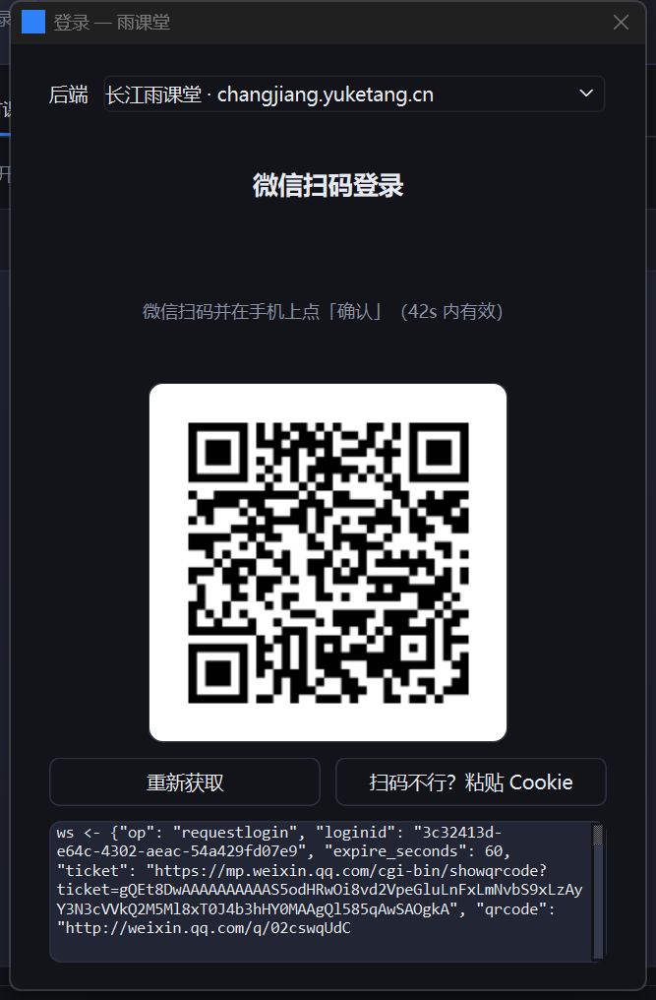

# 雨课堂协议研究

对**长江雨课堂**（`changjiang.yuketang.cn`）客户端与后端之间协议的独立研究笔记。

**这个仓库不含任何可执行客户端**——没有 exe、没有 apk、没有可以直接跑起来签到的东西。
它只保留两样东西：**协议规格**与**研究证据**。

<br>

| | |
|---|---|
| 📄 **协议规格** | [docs/PROTOCOL.md](docs/PROTOCOL.md) —— 照着自己就能实现 |
| 🔍 **研究记录** | [docs/FINDINGS.md](docs/FINDINGS.md) —— 证据、踩坑、以及被推翻的假设 |
| ⚖️ **合规评估** | [SECURITY.md](SECURITY.md) —— 逐条法条与入罪门槛 |

---

## 为什么这里没有客户端

因为写完之后发现，**"能跑的程序"和"能读的笔记"的法律性质不一样**。

刑法 285 条 3 款「提供侵入、非法控制计算机信息系统程序、工具罪」，
按[法释〔2011〕19 号](https://www.court.gov.cn/zixun/xiangqing/7494.html) 第三条，
「提供这类工具 **20 人次以上**」即属情节严重——**这一项不看有没有赚钱**。

而 [(2019)苏0623刑初535号](http://www.bjjbls.com/NewsDetail.aspx?ID=5654) 里，
16 个「学习平台辅助程序」中有 15 个**只是模拟键鼠、机器浏览视频刷时长**，
没有任何加密被破解，仍被判 **3 年 + 罚金 30 万**。法院的落点是
「自动化改变了平台内的数据」，不是「是否突破密码学防护」。

所以这里的取舍是：**保留到「能复现」的程度，去掉「能下载即用」的那一层。**
协议写全，程序不给。想用的人得自己写，写的过程里自然会知道它在干什么。

不是道德姿态，是风险定价。

---

## 核心结论（三条）

### 1. v3 接口的凭证是 `sid`，不是 `sessionid`

```
cookie "sessionid=X"          -> 50000 UNAUTHENTICATED
cookie "sessionid=X; sid=Y"   -> code 0
```

`sid` 由**官方 App 登录**下发，Web 扫码拿不到，且与 `sessionid` 不绑定。

### 2. 网关还有一道 `X-Client: app`

同一个 `sessionid`，`X-Client: web/android/ios` → HTTP 401；`app` → 进入业务层。

### 3. 签到与进班是同一个请求

```
POST /api/v3/lesson/checkin
{"source":23, "lessonId":"<字符串>", "joinIfNotIn":true}
```

`joinIfNotIn` 的语义是「不在班就直接进班」，所以一次调用同时完成进班与签到，
不需要 5 位课堂暗号，也不需要扫大屏二维码。

完整字段、请求头、错误码、抓包方法见 [docs/PROTOCOL.md](docs/PROTOCOL.md)。

---

## 这个研究过程中被推翻过三次

写在最显眼的位置，因为过程比结论有用：

1. **「凭 `sessionid` 直连 `lesson-summary/student` 就能进班」** → 错。
   那接口是**课后学习报告**，对在册学生也返回 `data.errorCode:-1`，且它拒绝时顶层 `code` 仍是 0
2. **「`lesson-summary/student` 是进班接口」** → 错。它在官方 App 的 214 条路径里出现 0 次
3. **「`X-Client: app` + Web 的 `Auth` 就能过 v3」** → 错。真正的门是 `sid` cookie

另外还有两条我自己写错的判断，都已更正：
**「`sid` 一次拿到可以长期用」**（实际约 2 小时）、**「没有暗号就签不了」**（`joinIfNotIn` 破解了这个说法）。

细节与证据见 [docs/FINDINGS.md](docs/FINDINGS.md)。

---

## 如果只想看懂，不需要动手

按这个顺序读：

1. [docs/PROTOCOL.md](docs/PROTOCOL.md) 第 2 节「两套凭证」—— 全篇的钥匙
2. 同文件第 6 节「签到」—— `joinIfNotIn` 是核心语义
3. 第 8 节「错误码」—— 那张表能解释 90% 的失败
4. [docs/FINDINGS.md](docs/FINDINGS.md) 第一节 —— 看看三条结论是怎么被推翻的

## 如果想自己复现

[PROTOCOL.md 第 12 节](docs/PROTOCOL.md#12-复现建议)给了一条最小路径，
四步之外都是锦上添花。

**注意这不是一条「照着做就成功」的路**：平台随时会改协议、加签名、上设备指纹。
`sid` 约 2 小时过期，图形验证码需要官方前端才能通过。这些限制我没有绕，也不打算绕。

---

## 仓库内容

```
docs/PROTOCOL.md       协议规格：端点、请求头、凭证、错误码、抓包方法
docs/FINDINGS.md       研究记录：证据、推翻过程、端点状态总表
SECURITY.md            凭据处理、能力边界、开源合法性与风险矩阵
NOTICE.md              来源致谢 + 商标声明
LICENSE                MIT
tools/secret_scan.py   提交前凭据自检（扫工作区 + 全部 git 历史）
```

**不包含**：客户端源码、桌面 exe、Android apk、抓包脚本、任何真实凭据。

---

## 已知限制

- **`sid` 约 2 小时过期**，是会话级凭证，不是长期令牌
- **图形验证码未解决**，发短信仍需要官方前端
- **开课检测字段名不固定**，不同部署要兜多套命名
- **轮询别拉满**：`/api/v3/*` 走统一网关，高频会撞限流

---

## 安全与合规

先读 [SECURITY.md](SECURITY.md)。其中第 5 节按法条逐项给了风险等级，包括：

- 著作权与「规避技术措施」为什么低（没有破解加密、没有复制代码）
- **刑法 285 条 3 款为什么是真正的风险点**（20 人次门槛 + 那份判例）
- 反不正当竞争法 12 条的现实适用空间
- 学校纪律为什么是唯一标「高」的一项

三条底线：**只操作自己的账号** · **人不在课堂时不要自动签到** · **永不收费**。

本项目与北京慕华信息科技有限公司**无任何隶属或授权关系**。
「雨课堂」「长江雨课堂」「学堂在线」及相关标识归该公司所有。

---

## 致谢

- **[《工小湖：给雨课堂与学校教务做了个小程序》](https://blog.jiclub.site/2026/yuketang-deep-dive)** by Cталин
- **[RainClassSDK](https://github.com/Auto-CQUPT-Plan/RainClassSDK)** by Auto-CQUPT-Plan
- **[rainclassroom-scrapper](https://gitbucket.skyw.top/physicsdolphin/rainclassroom-scrapper)** by physicsdolphin —— WebSocket 扫码登录的实现，没有这份参考本项目登录部分无从下手
- **[Ajax 的雨课堂爬虫笔记](https://aajax.top/2025/01/10/YuketangScrapper/)** —— `offset` 实为 PageSize 的坑

详见 [NOTICE.md](NOTICE.md)。

---

<details>
<summary>附录：研究期间的验证客户端（已不再分发）</summary>

<br>

研究过程中写过一套客户端用于验证结论（PySide6 桌面版 + 纯 Java Android 版），
现在不再提供源码与产物，仅留截图作为「这些结论确实跑通过」的证据。




保留它们的意义是：文档里那些「实测通过」不是推演出来的。

</details>

---

## 许可

[MIT](LICENSE) © 2026 SHUIZHILANLL
